<p align="center">
  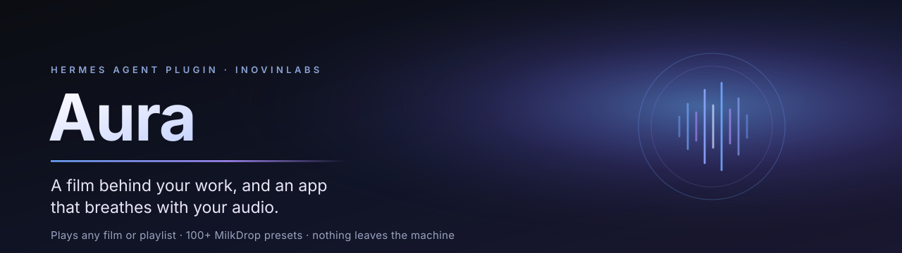
</p>

<h1 align="center">Aura</h1>

<p align="center"><i>A film behind your work, and an app that breathes with your audio.</i></p>

<p align="center">
  <a href="https://github.com/KeyArgo/hermes-aura/actions/workflows/tests.yml"></a>
  <a href="TESTING.md"></a>
  <a href="https://github.com/NousResearch/hermes-agent/pull/154027"></a>
  <a href="LICENSE"></a>
  <a href="https://github.com/NousResearch/hermes-agent"></a>
  
  
  
  <a href="https://github.com/KeyArgo/hermes-aura/stargazers"></a>
</p>


<p align="center">
  
  
  
  
</p>

<p align="center">
  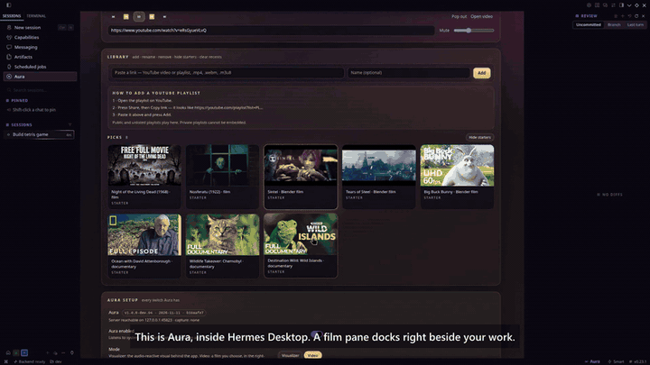
</p>

<p align="center"><sub><b>Aura inside Hermes Desktop</b>: the film pane beside your work, then the same audio driving the visualiser.
Recorded on the catalog-pinned build; the current release draws the visualiser in Aura's own pane — see
<a href="#where-the-visual-lives">where the visual lives</a>. The plugin asks Hermes for a backdrop area so the full-window version can return.
<a href="https://x.com/MHArgonaut/status/2120634853146435961">Watch the full 50-second demo ▶</a></sub></p>

<p align="center">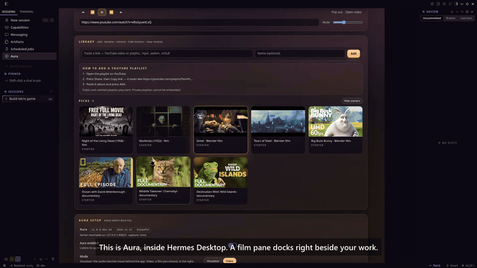
<br/><sub><b>A film behind your work.</b> Pick one from the shelf and keep chatting while it plays behind the conversation.</sub></p>

<p align="center">
  <a href="#install">Install</a> ·
  <a href="#features">Features</a> ·
  <a href="#how-it-works">How it works</a> ·
  <a href="#documentation">Documentation</a> ·
  <a href="#testing">Testing</a> ·
  <a href="#contributing">Contributing</a>
</p>

---

## What it is

Aura turns Hermes Desktop into a room you can live in. Put any film, lecture or
playlist in the right-hand pane and keep working; switch the film off and the
same audio drives a MilkDrop-compatible visualiser. It
listens to what the machine is already playing — system loopback, never the
microphone — and nothing leaves the computer: no account, no uploads, no
recording.

> Aura is not a music-service integration. It needs no Spotify, no YouTube Music
> and no account of any kind. If the speakers are making a sound, Aura can see it.

## Why it's different

- **One audio path, two jobs.** The soundtrack of the film you watch is the same
  signal that paints the room. There is no second player and no second capture.
- **A player with three surfaces, not three players.** The film exists in the
  docked pane, the Aura page or its own OS window — exactly one at a time, with
  the position kept per film.
- **The agent is a remote, not a script.** Pause, seek, next episode, pop out,
  find something to watch, find a radio station: all through three tools that
  return JSON and never autoplay.
- **Private by construction.** Loopback only, analysed in memory, no recording,
  no telemetry, a local server bound to `127.0.0.1` with a per-launch token.
- **Linux-first and honest about it.** PipeWire and PulseAudio are tested;
  Windows is implemented but unproven; macOS needs a virtual audio device.

---

### Where the visual lives

The visualiser and the film render inside Aura's own surfaces — the docked pane, the Aura page and
the floating watch window. Hermes' plugin SDK has no "draw behind the app" area yet (the request is
drafted for the maintainers), so nothing is painted over your chat; the pane is the surface that
streams audio from the backend, and that stream is what keeps capture awake on a cold start.

## Features

### Watch while you work

- **A docked theatre pane** on the right: 16:9 stage, scrubber, transport,
  volume, and a poster list of your sources. Closing it leaves only the
  status-bar menu.
- **YouTube videos, YouTube playlists, direct MP4/WebM.** Any public or unlisted
  playlist link works.
- **Per-film resume.** Every film remembers where you stopped, keyed by URL, so
  switching sources all day never restarts anything. A film that reaches the end
  is not remembered as being at its last second.
- **Playlist episodes.** Next/previous move through the episodes of a playlist,
  and fall back to your saved sources when the current source is a single video.
- **Auto-skip.** A playlist item that forbids embedding (or has been deleted)
  would otherwise break the whole list, so Aura resolves the playlist
  server-side and moves to the next playable episode.
- **Manage a playlist where it lives.** `☰` hands the list to the pop-out
  window — real Chromium on its own profile — so YouTube's own page opens and
  adding, removing and reordering work with your own session. No API scope, no
  OAuth review, no second account.
- **Subtitles you control.** A **CC** button on the control strip, the pane, the
  Aura page and the A menu turns the film's captions on and off, and the choice
  is remembered. When a video has several caption tracks the menu lists the ones
  it actually has and switches between them (Automatic means your machine's
  language, then English); YouTube forgets captions per video, so Aura
  re-applies the choice on every episode. A video with no caption track greys
  the button out — *No subtitles for this video*. **Subtitles burned into the
  picture cannot be turned off**: no player API exposes them, so the CC button
  cannot remove them. That is the upload's choice, not a setting of ours.
- **Free placement.** The floating watch window drags anywhere and remembers its
  spot; 320 / 480 / 640 wide. Its control strip is two rows — the film's title,
  scrubber, clock, volume and window buttons above a centred transport row —
  stays inside the viewport, and dims when idle instead of vanishing.
- **An Aura page in the sidebar — the whole product in one place.** The same
  film in a big 16:9 frame with the transport, volume and source picker, a
  **Library** of poster cards (add, rename, remove, hide starters, clear
  recents), the playlist how-to, and every setting Aura has underneath. Dark
  glass over a violet-to-ember gradient, scoped to `#aura-page`. It is the
  *same* player — the film moves into the page while it is open and goes back
  when you leave. **Pop out** floats it in a watch window you can drag anywhere;
  **Bring back** returns it to the page.
- **One library, two pickers.** The source dropdowns in the A menu and in
  Settings list everything — saved playlists, your films, the starter pack and
  recents — grouped under `Playlists`, `Your films`, `Starters` and `Recent`. A
  small **Edit sources…** link opens the Aura page, where editing lives. The
  starter pack is now a backdrop shelf as much as a film shelf: 32 entries,
  half of them 2–12 hour single takes — BBC Earth oceanscapes, NASA and ISS
  material, Monterey Bay Aquarium tanks, cab rides, city walks, silent drone
  aerials, rain and fireplace beds — plus Blender's open movies (CC-BY) and two
  public-domain features served straight from the Internet Archive.
- **A film owns the screen.** While Backdrop is **Video player**, Style,
  Intensity, the Aura transparency and Gentle motion are greyed out (they only
  describe the Aura visual), and Show is forced to Always in effect: a playing
  film is never faded out by “Only while active”. The video's own transparency
  stays live. Your stored Show choice is not overwritten — switch back to the
  Aura visual and it returns.
- **REVamp, next door.** Aura has no music library of its own.
  [REVamp](https://github.com/KeyArgo/hermes-revamp) is a Winamp-style player for
  Hermes, and Aura's visuals react to whatever it plays — one card on the page,
  one line in Settings.

### Watch the machine

- A MilkDrop-compatible WebGL visualiser driven by system audio — level, bands,
  silence gating.
- **140 curated presets** from the Butterchurn packs Aura ships.
- Backdrop opacity that follows the room: dim when quiet, brighter with music,
  with manual presets.
- An optional accent that follows the audio, and agent moods: thinking, running
  tools, waiting for approval, erroring, streaming, finished — each restores
  itself, nothing latches.

### Listen to anything

Aura listens to more than a film's soundtrack: internet radio, direct audio
files and streams play on their own channel, beside the video and independent
of it.

- **Radio.** A curated starter list (SomaFM, NTS, KEXP, FIP, Radio Paradise, BBC
  World Service and more), a search across the
  [Radio Browser](https://www.radio-browser.info/) directory by name or genre
  tag, and favourites that persist between sessions. `.pls` and `.m3u`
  playlists are resolved server-side, so a playlist link behaves like a station.
- **Direct audio.** Any public `http(s)` URL to mp3, ogg/opus, aac/m4a, flac or
  wav.
- **Music on, video muted.** The audio channel has its own volume and mute, so a
  film can run silently while music plays — watch the lecture, listen to the
  radio. The muted state is remembered with the film.
- **Ask the agent.** The **`aura_listen`** tool searches radio, shows numbered
  choices, waits for your pick, then plays it: *“find me some jazz radio”* → a
  numbered list → *“the second one”*. It can also stop the audio, set its
  volume, or mute/unmute the video without touching the music.
- **Visuals follow it.** Nothing new feeds the visualiser: Aura already reacts
  to system audio, so music from Aura's own channel (or any other app) drives the
  same visuals.

**Aura is a media player, not a Winamp.** If you want a Winamp-style player with
your local library, audiobooks, skins and a 90s attitude, install **REVamp** — it
is the same author's other plugin, and Aura's visuals react to whatever it plays.

### Control it by talking to Hermes

Because the server is the remote, anything in the window can still be driven
from the chat — no alt-tab, no reaching for the mouse:

- “pause” / “resume” / “next episode” / “go back an episode”
- “jump to 40 minutes” (seek)
- “put it on my other screen” / “pop the film out” / “bring it back into Hermes”
- “turn the subtitles on” / “turn them off” (`action=captions`)

The agent calls `aura_control` with
`action=pause|resume|next|prev|seek|popout|popin`, and `action=status` answers
“what is playing?” with the title, position, duration and whether the window is
open. Commands go through a small server-side queue
(`/api/player/command`), which the desktop window polls about three times a
second and applies to the same player code the in-app transport uses.

### Ask Hermes for something to watch

You do not need a link. Say what you are in the mood for:

> **You:** I want to watch a documentary about octopuses.
> **Hermes:** Here are a few — say the number:
> 1. Secrets of the Octopus: the Ocean's Masterminds · Nat Geo Animals · 2:03:39 · youtube.com/watch?v=3GB-7qwwIp0
> 2. Full octopus documentaries · Timely Documentaries · 8 videos · youtube.com/playlist?list=PL…
> 3. Masterminds: Secrets of the Octopus (Full Episode) · National Geographic · 42:32 · youtube.com/watch?v=ah8U0-fV6k8
> **You:** 2
> **Hermes:** Playing “Full octopus documentaries” in Aura.

The agent calls **`aura_watch`** with `action=search`, shows the numbered
options (title, channel, length and link) and stops. Nothing plays until you
pick; then it calls `action=play`, which puts the choice on the same player
queue the transport buttons use — so it starts in the docked pane, the Aura page
or the popped-out window, whichever is showing the film. `action=now` answers
“what is playing?” without opening anything.

Search is keyless: it reads YouTube's public results page, caches the answer for
five minutes, and returns nothing rather than an error when YouTube is
unreachable (the agent then says so, and can fall back to its own web search with
a direct link). `action=play` accepts YouTube watch / `youtu.be` / shorts / embed
/ playlist links and direct `.mp4`, `.webm`, `.m3u8` and `.mov` files. The
dashboard also exposes the same search as
`GET /api/plugins/aura/search?q=…&limit=…`.

### The shelf: 346 titles, on the page and by name

The Aura page opens with **Picks** — the starter films — then one row per
category: Deep sea & oceans, Nature & wildlife, Space & astronomy, Earth from
above, Slow TV, Classic films, Classic cartoons, Anime, Open movies, Science &
history docs and Ambience. Every row scrolls sideways, each card names the
title, year and length and shows its one-line note on hover, and one click plays
it through the same path a picked source takes. One search box filters every row
at once. The catalogue is a committed file (`web/catalog.json`, built by
`tools/build_catalog.py` from the verified rows) served by
`GET /api/catalog`, so it works offline and nothing is fetched from YouTube or
archive.org at runtime.

Ask for one by name and Hermes browses the same list without touching the
network:

> **You:** find me a noir film
> **Hermes:** Here are a few from Aura's catalogue — say the number:
> 1. The Cabinet of Dr. Caligari (1920) · Classic films · archive.org/…
> 2. Dr. Mabuse the Gambler (1922) · Classic films · archive.org/…
> 3. Detour (1945) · Classic films · archive.org/…

`aura_watch action=browse` takes an optional `category` and an optional `query`
(words from a title or its description), returns up to ten matches (title, year,
category, url) and lists the categories when given neither. It shows the
numbered options and stops, exactly like `action=search`; the pick then plays
through `action=play`.

### Keep your own list, by asking

Aura's Library (the **Playlists** and **Your films** groups in the source
picker) is the list you save, not a YouTube account's. Hermes can change it:

> **You:** save this
> **Hermes:** Saved to your Aura library (films): Secrets of the Octopus
>
> **You:** add the octopus one to my list
> **Hermes:** Saved to your Aura library (playlists): Full octopus documentaries
>
> **You:** remove Nosferatu
> **Hermes:** Removed from your Aura library: Nosferatu
>
> **You:** what's on my list?
> **Hermes:** 1. Nosferatu · film · youtube.com/watch?v=… (and the rest)

`aura_watch` gains `action=save` (the `url` may be left out — “save this” saves
what is playing, and `label` defaults to the title the player already knows),
`action=remove` (`url`, or a `label` that matches exactly or uniquely, ignoring
case) and `action=list`. A playlist link is saved as a playlist and everything
else as a film, the same URL is never saved twice, and the same URL rules as
`action=play` apply. An ambiguous title returns the matches and changes nothing.

All three actions ride the same `/api/player/command` queue: the desktop handles
`save`/`remove` with the helpers its own Add and Remove buttons use, so the page
updates live and shows a short note (“Saved to your Aura library”). For
`action=list` the desktop adds the saved list (`library`) to the player report it
already sends (`/api/player/report`), and the server keeps the last one — if no
desktop has reported yet, the tool says “not reported yet” instead of inventing
a list. Nothing here touches YouTube's own playlists.

### The plugin surface

- Status-bar **A** menu: play/pause, seek, volume, source picker, watch window,
  Aura panel.
- A sidebar **Aura** page: the film, the transport and the full setup in one
  place.
- A settings page with every control, including dropdown lists that stay
  readable on dark themes.
- The **`aura_control`** tool, so the agent itself can set the room; the
  **`aura_listen`** tool for radio search and the audio channel; the
  **`aura_watch`** tool to find something to watch, start the choice you pick,
  and save, remove or list what is in your own Library.
- Hooks: session start/end, `pre`/`post_tool_call`, approval request/response,
  `api_request_error`, stream start/end, subagent start/stop.

### Screenshots


<table>
  <tr>
    <td width="50%" align="center">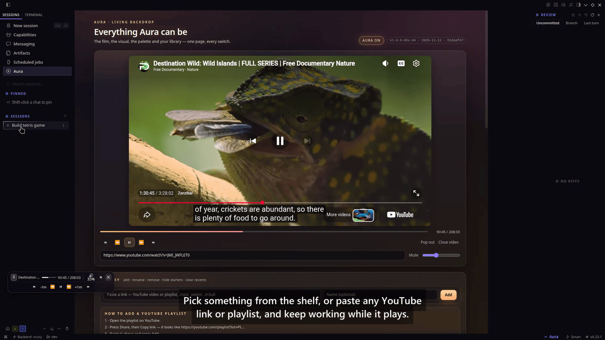<br><sub><b>The film pane</b><br>A film docked beside your work in Hermes Desktop.</sub></td>
    <td width="50%" align="center">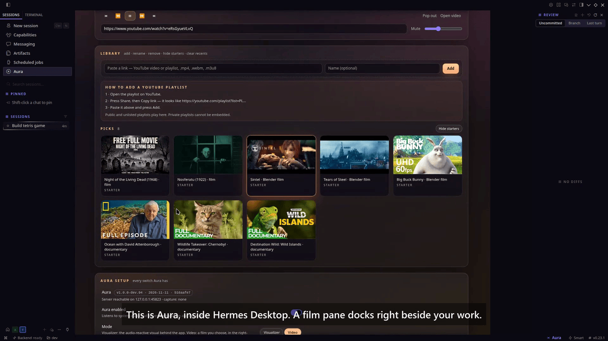<br><sub><b>The shelf</b><br>Pick a film, or paste any YouTube link or playlist.</sub></td>
  </tr>
  <tr>
    <td width="50%" align="center">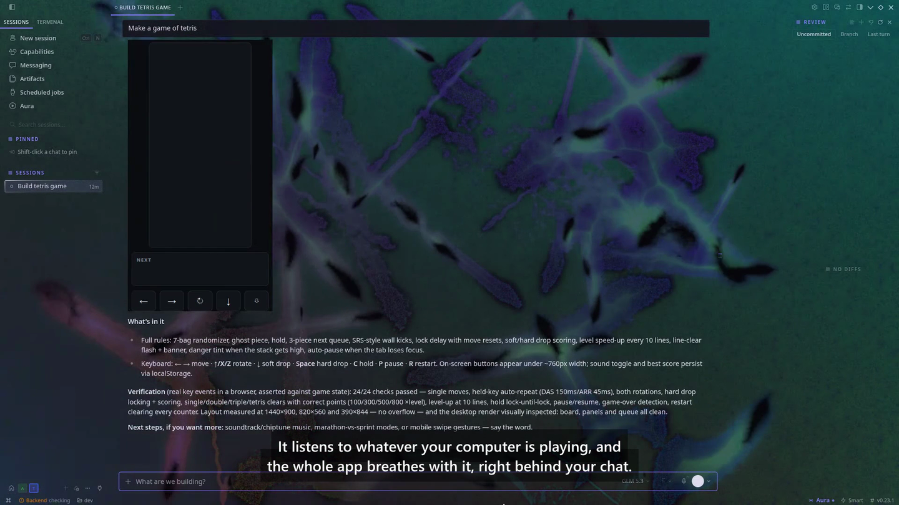<br><sub><b>Behind the chat</b><br>The whole app breathes with what is playing.</sub></td>
    <td width="50%" align="center">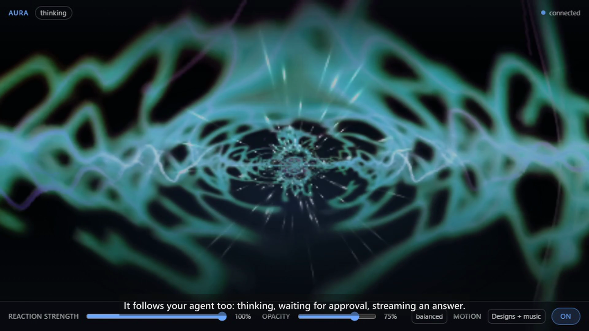<br><sub><b>It follows the agent</b><br>Thinking, waiting for approval, streaming an answer.</sub></td>
  </tr>
  <tr>
    <td width="50%" align="center">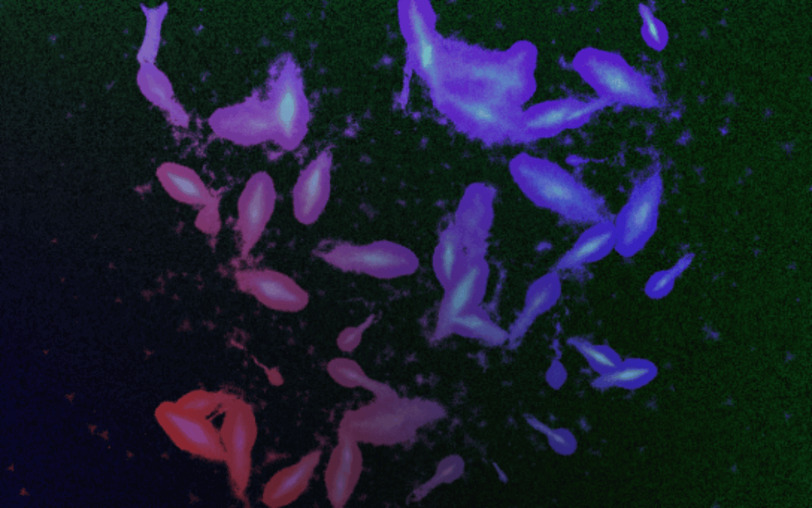<br><sub><b>Eo.S. + Zylot — skylight</b><br>Stained-glass blooms over a dark room.</sub></td>
    <td width="50%" align="center">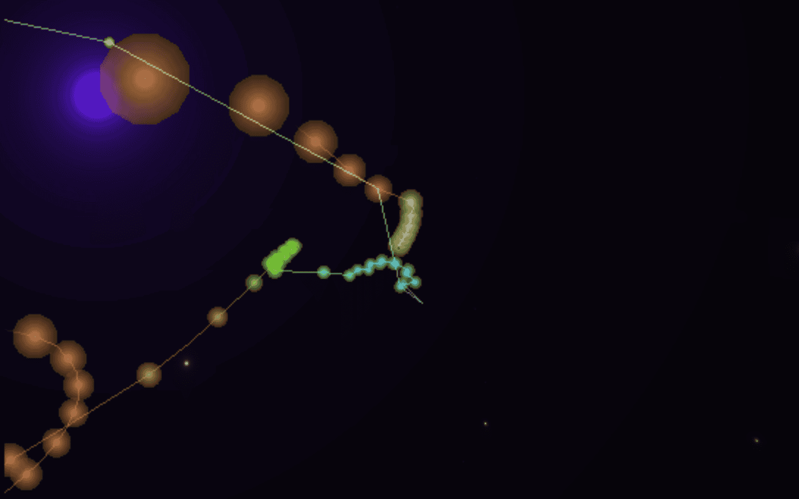<br><sub><b>Flexi, fishbrain, Geiss + Martin — tokamak witchery</b><br>Particles drift with the low end.</sub></td>
  </tr>
  <tr>
    <td width="50%" align="center">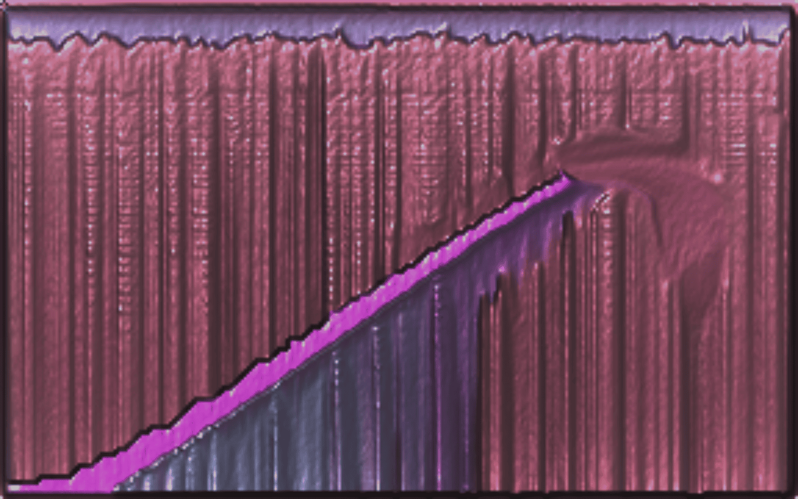<br><sub><b>Geiss — Spiral Artifact</b><br>A rigid, geometric reaction.</sub></td>
    <td width="50%" align="center">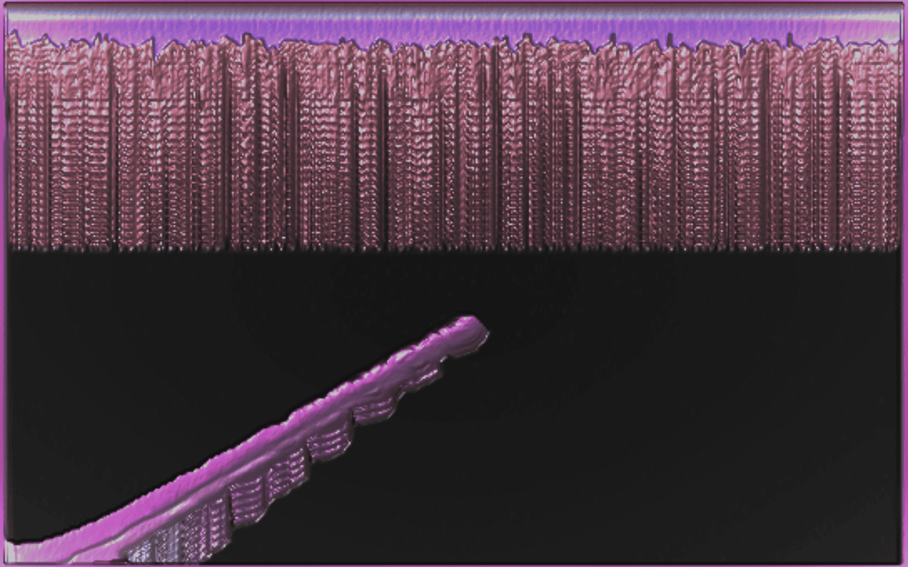<br><sub><b>Flexi — infused with the spiral</b><br>Organic ribbons on the beat.</sub></td>
  </tr>
  <tr>
    <td width="50%" align="center">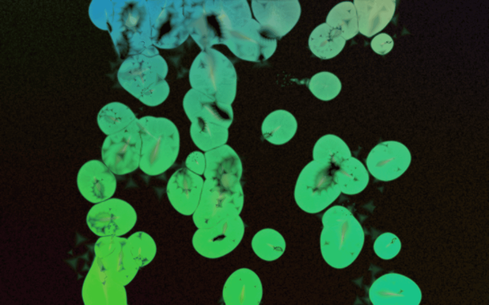<br><sub><b>Flexi + Geiss — pogo-cubes on tokamak matter</b><br>Cells that breathe with the mix.</sub></td>
    <td width="50%" align="center">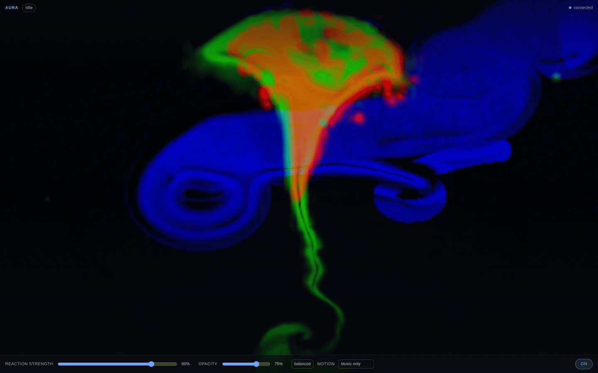<br><sub><b>The page at 1440 × 900</b><br>Reaction strength, opacity, behaviour and motion.</sub></td>
  </tr>
</table>

<sub>All six are real renders captured 2026-11-11 from the shipped Butterchurn
build and preset set, driven through an analyser by a synthetic signal. The
visualiser is the part that renders identically headless; the Hermes pane and
page chrome are drawn by the host.</sub>

---

## Install

```bash
hermes plugins install KeyArgo/hermes-aura --yes-deps --enable
```

Then turn it on in **Settings ▸ Plugins ▸ Aura**. The Aura pane appears on the
right; closing it leaves only the status-bar menu. Nothing is captured until
Aura is enabled.

**Requirements:** Hermes Agent 0.22.5 or newer. Linux with PipeWire or
PulseAudio for audio capture. Chrome or Chromium for the pop-out window.
Python 3.11+ and Node 18+ for development. Windows capture uses the
`soundcard`/`numpy` dependencies declared in `plugin.yaml` and installs
automatically there; macOS needs a virtual audio device.

### Quick start

1. Install and enable Aura (above).
2. Open the status-bar **A** menu and pick a film, or paste a YouTube video or
   playlist URL. The Aura page names what is playing above the big player.
3. Work. The film plays in the right-hand pane.
4. Switch the film off and the same audio paints the visualiser behind the
   interface.
5. Ask Hermes for something: *“find me a documentary about octopuses”* or
   *“find me some jazz radio”*.

### Adding a YouTube playlist

1. Open the playlist on YouTube.
2. Press **Share**, then **Copy link** — it looks like
   `https://youtube.com/playlist?list=PL…`.
3. On the Aura page, paste it into the Library box, give it a name if you like,
   and press **Add**.

Public and unlisted playlists play here. Private playlists cannot be embedded
and are not supported.

### Upgrading, uninstalling and your data

- **Upgrade:** reinstall with the command above. Settings and sources are kept
  in `~/.hermes/aura/`.
- **Uninstall:** remove the plugin through Hermes' plugin list. The local
  server exits with the plugin process.
- **Delete your data:** remove `~/.hermes/aura/` while Aura is off. That folder
  holds `config.json`, the token, `server.lock`, `lease.json` and
  `radio_favorites.json`. Nothing is written anywhere else; audio samples never
  touch disk.

---

## How it works

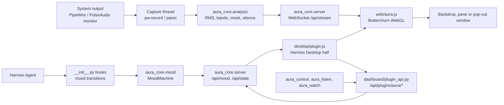

`aura_core/capture/` probes PipeWire, PulseAudio, WASAPI and macOS in order and
starts a monitor recorder. `aura_core/analysis.py` reduces each 1024-sample
frame to RMS level, eight bands, onset, centroid, flatness and a silence flag.
`aura_core/server.py` streams raw PCM and feature events over one token-gated
WebSocket; `web/aura.js` feeds the PCM to Butterchurn and uses the features for
level, bands, silence gating and moods. `desktop/plugin.js` owns the Hermes
surfaces and talks to the server only through `dashboard/plugin_api.py`, so it
never guesses a port. `__init__.py` maps eleven agent hooks onto
`aura_core/mood.MoodMachine` and registers the three tools.

The film has one player and three surfaces. The diagram below is the shape of
that rule; the film moves, and the surface that loses it does not keep a copy.

<p align="center">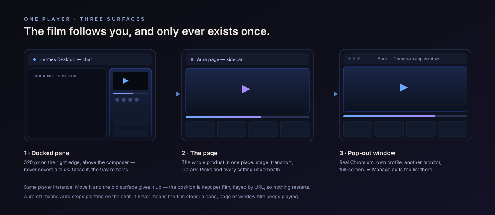</p>

### Frame in Hermes, or pop out to desktop

Two buttons, the same words on the quick menu, the right panel, the Aura page
and the floating control strip. **Frame in Hermes** keeps the film in a movable
frame inside Hermes (the button stays pressed while it does). **Pop out to
desktop** sends it to a real OS window — Chrome/Chromium app mode — that you can
drag to another monitor or full-screen. While that window holds the film the
button reads **Bring back**.

The frame is a frame: it carries its own bar along the top edge with the film's
title, a grip, and its own **Bring back**, **Pop out to desktop** and **close**.
Drag the bar and the frame goes with the pointer — only the frame, which keeps
its own position (clamped to the window and remembered across a restart); the
floating control strip has a separate position and never follows.

Pop-out opens at the exact second the in-app player had reached, and the in-app
one pauses so two copies never play with sound.

The pop-out needs Chrome or Chromium. Aura asks the server first: if it answers
that this machine has no browser, the film stays in its frame inside Hermes and
Aura says why. If the window fails to open, Aura shows the server's own reason
in a note and leaves the film exactly where it was — it never quietly turns a
failed pop-out into the in-app frame. Set `AURA_DESKTOP_BROWSER=/path/to/chrome`
to point it at one. The window uses
its own browser profile, so it never touches your normal browsing session. If
the Aura server restarts (or the app quits), the window is closed with it — a
stale window could play audio nothing can control.

The right panel is the film's panel: it is on screen while the backdrop is the
video player and the film is open, and it goes away on its own in the Aura
visual mode (or when you close the film), coming back when video mode does. The
**Right panel** switch in Settings means "show it in video mode".

Music and radio do not depend on that panel. Their page lives in a hidden seat
of Aura's own, so radio keeps playing in visualiser mode with no panel on screen
— and when a panel, the page or the pop-out takes the film back, the music
follows it instead of going silent.

### The audio path

<p align="center">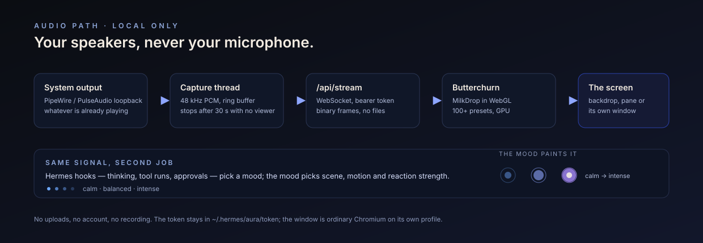</p>

The capture thread reads the default sink's monitor, not a microphone. When the
last Aura surface closes, capture drops to silence after 30 seconds and reopens
when a surface returns, unless `listen_background` is set. The detailed file map
is in [docs/ARCHITECTURE.md](docs/ARCHITECTURE.md).

---

## Documentation

| Document | What it answers |
|---|---|
| [docs/USAGE.md](docs/USAGE.md) | Every feature as a walkthrough, with screenshots. |
| [docs/ARCHITECTURE.md](docs/ARCHITECTURE.md) | Components, data flow, files on disk, key files. |
| [docs/REFERENCE.md](docs/REFERENCE.md) | Every tool, hook, route and config key. |
| [docs/CONFIGURATION.md](docs/CONFIGURATION.md) | Every setting and environment variable. |
| [docs/TROUBLESHOOTING.md](docs/TROUBLESHOOTING.md) | Real failure modes and fixes. |
| [docs/DEVELOPMENT.md](docs/DEVELOPMENT.md) | Repo layout, local setup, CI. |
| [docs/FAQ.md](docs/FAQ.md) | Short answers to common questions. |
| [docs/README.md](docs/README.md) | The documentation index. |
| [TESTING.md](TESTING.md) | Commands, suite counts, what CI runs. |
| [VERIFY.md](VERIFY.md) | What was verified on a clean checkout, and what was not. |
| [CONTRACT.md](CONTRACT.md) | The wire contract between the server, page, desktop half and hooks. |
| [LIMITS.md](LIMITS.md) | Known limits, stated plainly. |
| [SPIKES.md](SPIKES.md) | Measurements that shaped the design. |
| [CHANGELOG.md](CHANGELOG.md) | Release history. |
| [CONTRIBUTING.md](CONTRIBUTING.md) · [CODE_OF_CONDUCT.md](CODE_OF_CONDUCT.md) | How to send a change and how we work together. |
| [SECURITY.md](SECURITY.md) | What Aura touches and how to report a vulnerability. |
| [THIRD_PARTY_NOTICES.md](THIRD_PARTY_NOTICES.md) | Vendored libraries and preset attribution. |

---

## Privacy & security

**What Aura stores.** Settings, a per-launch token, a server lease/lock and radio
favourites in `~/.hermes/aura/` (mode `0600`). Nothing else.

**Network calls.** The local server binds `127.0.0.1` and requires a per-launch
token. Films are fetched from the URLs you choose. Keyless YouTube search reads
YouTube's public results page and caches it for five minutes. Radio search
queries [Radio Browser](https://www.radio-browser.info/); `.pls`/`.m3u`
resolution and the audio stream proxy go through the local server so the browser
never follows an unchecked redirect. No account, no telemetry, no self-updater.

**Background processes.** A capture process (`pw-record` or `parec`) while Aura
is listening, the local HTTP server, and — only when you ask — a Chromium app
window on its own profile. Capture stops after 30 seconds with no Aura surface,
and immediately when Aura is turned off or the motion mode does not use audio.

**Shell commands.** Aura starts `pw-record`/`parec` for capture, `pactl` or
`pw-dump` to find the monitor, and the chosen Chromium binary for the pop-out.
It does not run a shell, and it does not touch host `html`/`body` styles.

**Host safety.** The pane is a Hermes `PANES_AREA` contribution — Hermes lays it
out; no fixed positioning, no z-index, no `body` padding. The film is an SDK
`<SandboxedFrame>` inside that pane, and the transport strip is a
`COMPOSER_AREAS.underside` contribution whose floating pill sits at the point the
user dragged it to (`videoBarX`/`videoBarY`) — no app markup is queried, nothing
is appended to the document body, and no host stylesheet is written. Host root
styles are never written; the
accent override is the SDK's sanctioned mechanism. Switching the visual off,
turning Aura off, **Restore my theme** and plugin disposal remove every effect
Aura applied and restore the theme that was there before.

Report a vulnerability privately via GitHub's **Security → Report a
vulnerability**; see [SECURITY.md](SECURITY.md). Do not open a public issue.

---

## Testing

```bash
python3 -m pytest tests -q -p no:cacheprovider --ignore=tests/e2e --ignore=tests/integration
node --test tests/test_desktop_plugin.mjs
```

| Suite | Result at this commit |
|---|---|
| Python (capture, analysis, server, hooks, tools, radio, search, catalogue) | **536 passed** |
| Desktop contract (menu, pane, transport, resume, mode gating, shelf) | **167 passed, 0 failed** |
| **Total** | **703 passed** |

The end-to-end visualiser tests drive a real headless Chrome and measure the
canvas. They skip themselves when the machine is too loaded to sample reliably
rather than reporting a false failure. Full commands, the CI job layout and what
is not covered are in [TESTING.md](TESTING.md) and [VERIFY.md](VERIFY.md).

---

## Limits

| Area | Status |
|---|---|
| Audio capture | **Linux** (PipeWire / PulseAudio monitor) — tested. Windows (WASAPI) is implemented but unproven on real hardware; macOS needs a virtual audio device. Treat Aura as Linux-first. |
| YouTube | Embeds play only when the uploader allows it. Aura detects the refusal and skips the episode; it cannot play a video that forbids embedding. |
| Netflix, Disney+, most streaming services | **Not possible** — their players refuse to be framed (DRM + `X-Frame-Options`). Aura offers “open in browser” instead. |
| Plex | Not built. A direct stream URL works; the server integration is not written. |
| Playlists | Resolved by reading the public playlist page — no API key, no OAuth. Public and unlisted lists only; private/account lists need Google sign-in and are unsupported. |
| Privacy | Audio is analysed in memory and never written or sent. No account, no telemetry. |

[LIMITS.md](LIMITS.md) has the two implementation limits worth knowing
(POSIX-only single-server election, host-styling layout risk).

Pre-release. [SPIKES.md](SPIKES.md) records what was actually measured;
[CONTRACT.md](CONTRACT.md) is the wire contract between the capture server, the
page, the desktop half and the agent hooks.

## Contributing

Bug reports, small focused fixes and new ideas are welcome. Read
[CONTRIBUTING.md](CONTRIBUTING.md) first; it covers the issue templates, the
checks to run, and the rule that a change touching privacy, network calls or
capabilities is reviewed first. Be kind: [CODE_OF_CONDUCT.md](CODE_OF_CONDUCT.md).

## License

MIT. See [LICENSE](LICENSE).

## Acknowledgements

- **Butterchurn** (MIT) by Jordan Berg and contributors — the MilkDrop-compatible
  WebGL renderer, used unmodified.
- **butterchurn-presets** (MIT) — the preset packs; the curated subset Aura
  ships keeps each preset author's name in its key. Individual credits are in
  [THIRD_PARTY_NOTICES.md](THIRD_PARTY_NOTICES.md).
- **REVamp** (MIT, same author) — the internet-radio layer in
  `aura_core/radio.py` is adapted from it, with a credit comment in the file.
- **Radio Browser** — the open community station directory.
- “MilkDrop” is referenced only in prose; Aura is not MilkDrop and is not
  affiliated with Winamp.

<p align="center">Built by <a href="https://github.com/KeyArgo">KeyArgo</a> · InovinLabs</p>
