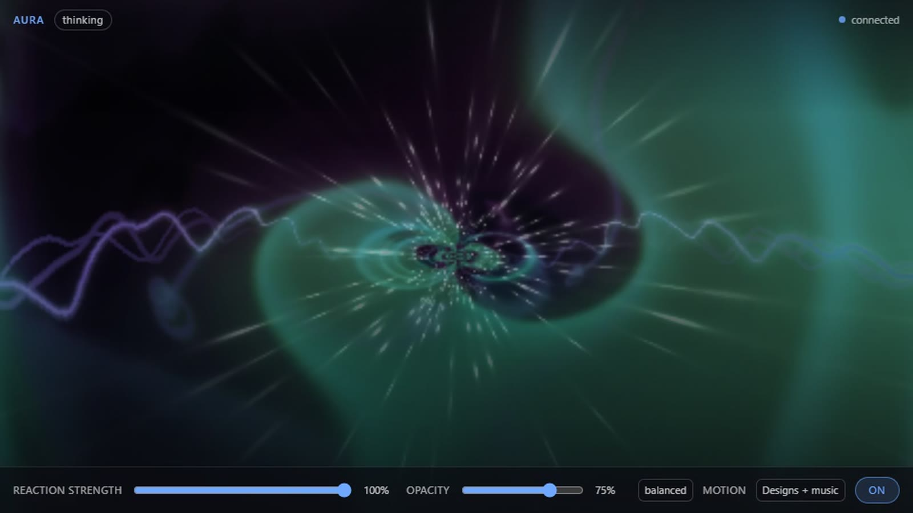

# Aura

[](https://github.com/KeyArgo/hermes-aura/releases/latest) [](LICENSE) [](https://github.com/NousResearch/hermes-agent) [](.github/workflows/tests.yml) [](#limits-stated-plainly) [](https://github.com/KeyArgo/hermes-aura/stargazers)

**A film behind your work, and an app that breathes with your audio.**



```bash
hermes plugins install KeyArgo/hermes-aura --yes-deps --enable
```

_Applies to v1.0.0 · revised 2026-11-10._

Aura turns Hermes Desktop into a room you can live in. Put any film, lecture or playlist in the
right-hand pane and keep working; switch the film off and the same audio drives a MilkDrop-compatible
visualiser behind the interface. It listens to what the machine is already playing — system loopback,
never the microphone — and nothing leaves the computer: no account, no uploads, no recording.

> Aura is not a music-service integration. It needs no Spotify, no YouTube Music and no account of any
> kind. If the speakers are making a sound, Aura can see it.

---

## Watch while you work

- **A docked theatre pane** on the right: 16:9 stage, scrubber, transport, volume, and a poster list of
  your sources. Closing it leaves only the status-bar menu.
- **YouTube videos, YouTube playlists, direct MP4/WebM.** Any public or unlisted playlist link works.
- **Per-film resume.** Every film remembers where you stopped, keyed by URL, so switching sources all day
  never restarts anything. A film that reaches the end is not remembered as being at its last second.
- **Playlist episodes.** Next/previous move through the episodes of a playlist, and fall back to your saved
  sources when the current source is a single video.
- **Auto-skip.** A playlist item that forbids embedding (or has been deleted) would otherwise break the
  whole list, so Aura resolves the playlist server-side and moves to the next playable episode.
- **Free placement.** The floating watch window drags anywhere and remembers its spot; 320 / 480 / 640
  wide. Its control strip is two rows — the film's title, scrubber, clock, volume and window buttons
  above a centred transport row — stays inside the viewport, and dims when idle instead of vanishing.
- **An Aura page in the sidebar — the whole product in one place.** One row opens a full page: the same
  film in a big 16:9 frame with the transport, volume and source picker, a **Library** of poster cards
  (add, rename, remove, hide starters, clear recents), the playlist how-to, and every setting Aura has
  underneath. Dark glass over a violet-to-ember gradient, scoped to `#aura-page`. It is the *same*
  player — the film moves into the page while it is open and goes back when you leave. **Pop out** on the
  page floats it in a watch window you can drag anywhere; **Bring back** returns it to the page.
- **One library, two pickers.** The source dropdowns in the A menu and in Settings list everything —
  saved playlists, your films, the starter pack and recents — grouped under `Playlists`, `Your films`,
  `Starters` and `Recent`. A small **Edit sources…** link opens the Aura page, where editing lives.
- **A film owns the screen.** While Backdrop is **Video player**, Style, Intensity, the Aura
  transparency and Gentle motion are greyed out (they only describe the Aura visual), and Show is
  forced to Always in effect: a playing film is never faded out by "Only while active". The video's own
  transparency stays live. Your stored Show choice is not overwritten — switch back to the Aura visual
  and it returns.
- **REVamp, next door.** Aura has no music library of its own. [REVamp](https://github.com/KeyArgo/hermes-revamp)
  is a Winamp-style player for Hermes, and Aura's visuals react to whatever it plays — one card on the page,
  one line in Settings.

## Adding a YouTube playlist (plain instructions)

1. Open the playlist on YouTube.
2. Press **Share**, then **Copy link** — it looks like `https://youtube.com/playlist?list=PL…`.
3. On the Aura page, paste it into the Library box, give it a name if you like, and press **Add**.

Public and unlisted playlists play here. Private playlists cannot be embedded and are not supported.

## Pop out to its own window

Click **Pop out** and the film leaves the Hermes window: a real OS window (Chrome/Chromium app mode)
that you can drag to another monitor or full-screen. It opens at the exact second the in-app player had
reached, and the in-app one pauses so two copies never play with sound. **Pop in** closes it again.

The pop-out needs Chrome or Chromium. If none is installed Aura says so plainly; set
`AURA_DESKTOP_BROWSER=/path/to/chrome` to point it at one. The window uses its own browser profile, so
it never touches your normal browsing session. If the Aura server restarts (or the app quits), the
window is closed with it — a stale window could play audio nothing can control.

## Control it by talking to Hermes

Because the server is the remote, anything in the window can still be driven from the chat — no
alt-tab, no reaching for the mouse:

- “pause” / “resume” / “next episode” / “go back an episode”
- “jump to 40 minutes” (seek)
- “put it on my other screen” / “pop the film out” / “bring it back into Hermes”

The agent calls `aura_control` with `action=pause|resume|next|prev|seek|popout|popin`, and
`action=status` answers “what is playing?” with the title, position, duration and whether the window is
open. Commands go through a small server-side queue (`/api/player/command`), which the desktop window
polls about three times a second and applies to the same player code the in-app transport uses.

## Ask Hermes for something to watch

You do not need a link. Say what you are in the mood for:

> **You:** I want to watch a documentary about octopuses.
> **Hermes:** Here are a few — say the number:
> 1. Secrets of the Octopus: the Ocean's Masterminds · Nat Geo Animals · 2:03:39 · youtube.com/watch?v=3GB-7qwwIp0
> 2. Full octopus documentaries · Timely Documentaries · 8 videos · youtube.com/playlist?list=PL…
> 3. Masterminds: Secrets of the Octopus (Full Episode) · National Geographic · 42:32 · youtube.com/watch?v=ah8U0-fV6k8
> **You:** 2
> **Hermes:** Playing “Full octopus documentaries” in Aura.

The agent calls **`aura_watch`** with `action=search`, shows the numbered options (title, channel,
length and link) and stops. Nothing plays until you pick; then it calls `action=play`, which puts the
choice on the same player queue the transport buttons use — so it starts in the docked pane, the Aura
page or the popped-out window, whichever is showing the film. `action=now` answers “what is playing?”
without opening anything.

Search is keyless: it reads YouTube's public results page, caches the answer for five minutes, and
returns nothing rather than an error when YouTube is unreachable (the agent then says so, and can fall
back to its own web search with a direct link). `action=play` accepts YouTube watch / `youtu.be` /
shorts / embed / playlist links and direct `.mp4`, `.webm`, `.m3u8` and `.mov` files. The dashboard
also exposes the same search as `GET /api/plugins/aura/search?q=…&limit=…`.

## Watch the machine

- A MilkDrop-compatible WebGL visualiser driven by system audio — level, bands, silence gating.
- Backdrop opacity that follows the room: dim when quiet, brighter with music, with manual presets.
- An optional accent that follows the audio, and agent moods: thinking, running tools, waiting for
  approval, erroring, streaming, finished — each restores itself, nothing latches.

## Listen to anything

Aura listens to more than a film's soundtrack: internet radio, direct audio files and
streams play on their own channel, beside the video and independent of it.

- **Radio.** A curated starter list (SomaFM, NTS, KEXP, FIP, Radio Paradise, BBC World
  Service and more), a search across the [Radio Browser](https://www.radio-browser.info/)
  directory by name or genre tag, and favourites that persist between sessions. `.pls` and
  `.m3u` playlists are resolved server-side, so a playlist link behaves like a station.
- **Direct audio.** Any public `http(s)` URL to mp3, ogg/opus, aac/m4a, flac or wav.
- **Music on, video muted.** The audio channel has its own volume and mute, so a film can run
  silently while music plays — watch the lecture, listen to the radio. The muted state is
  remembered with the film.
- **Ask the agent.** The **`aura_listen`** tool searches radio, shows numbered choices, waits
  for your pick, then plays it: *"find me some jazz radio"* → a numbered list → *"the second
  one"*. It can also stop the audio, set its volume, or mute/unmute the video without touching
  the music.
- **Visuals follow it.** Nothing new feeds the visualiser: Aura already reacts to system audio,
  so music from Aura's own channel (or any other app) drives the same visuals.

**Aura is a media player, not a Winamp.** If you want a Winamp-style player with your local
library, audiobooks, skins and a 90s attitude, install **REVamp** — it is the same author's
other plugin, and Aura's visuals react to whatever it plays.

## The plugin surface

- Status-bar **A** menu: play/pause, seek, volume, source picker, watch window, Aura panel.
- A sidebar **Aura** page: the film, the transport and the full setup in one place.
- A settings page with every control, including dropdown lists that stay readable on dark themes.
- The **`aura_control`** tool, so the agent itself can set the room; the **`aura_listen`** tool
  for radio search and the audio channel; the **`aura_watch`** tool to find something to watch
  and start the choice you pick.
- Hooks: session start/end, `pre`/`post_tool_call`, approval request/response, `api_request_error`,
  stream start/end, subagent start/stop.

---

## Install

```bash
hermes plugins install KeyArgo/hermes-aura --yes-deps --enable
```

Once Aura is listed in the Hermes plugin catalog, `hermes plugins install aura` works too.

Turn it on in **Settings ▸ Plugins ▸ Aura**. The Aura pane appears on the right; closing it leaves only
the status-bar menu. Nothing is captured until Aura is enabled.

---

## Limits, stated plainly

| Area | Status |
|---|---|
| Audio capture | **Linux** (PipeWire / PulseAudio monitor) — tested. **Windows** (WASAPI loopback through `soundcard`, installed automatically on Windows) — verified capturing system audio on Windows 11. macOS needs a virtual audio device. |
| YouTube | Embeds play only when the uploader allows it. Aura detects the refusal and skips the episode; it cannot play a video that forbids embedding. |
| Netflix, Disney+, most streaming services | **Not possible** — their players refuse to be framed (DRM + `X-Frame-Options`). Aura offers "open in browser" instead. |
| Plex | Not built. A direct stream URL works; the server integration is not written. |
| Playlists | Resolved by reading the public playlist page — no API key, no OAuth. Public and unlisted lists only; private/account lists need Google sign-in and are unsupported. |
| Privacy | Audio is analysed in memory and never written or sent. No account, no telemetry. |

---

## Host safety

The only host DOM Aura touches is opt-in and bounded:

- The pane is a `PANES_AREA` contribution — **Hermes lays it out**. No fixed positioning, no z-index, no
  `body` padding. (An earlier floating column did all three, pushed the host sidebar off its own panel and
  swallowed clicks; it is gone.)
- The backdrop is one click-through iframe at negative z-index, plus a single `#aura-glass` stylesheet,
  mounted only while a visual is showing and removed when it stops. With **Show: Only while active** both
  exist only while the visual moves.
- Host `html`/`body`/root styles are never written. The accent override is the SDK's sanctioned mechanism.
- Switching the visual off, turning Aura off, **Restore my theme** and plugin disposal all remove every
  effect Aura applied and restore the theme that was there before.

---

## Layout

```
plugin.yaml          manifest (hooks, tools, dashboard)
__init__.py          Python plugin: hooks, aura_control tool
aura_core/           capture, analysis, config, HTTP server, sessions, radio
dashboard/           plugin_api.py — the desktop half's REST door (incl. /radio/*)
desktop/plugin.js    Hermes Desktop half (status menu, pane, window, backdrop, audio)
web/                 visualiser (aura.js), audio channel (audio.js), film stage (player.html), presets
tests/               Python suite + the desktop DOM contract suite
```

## Development

```bash
.venv/bin/python -m pytest tests/ -q          # server, capture, analysis
node --test tests/test_desktop_plugin.mjs     # desktop half against a fake host DOM
```

The end-to-end visualiser tests drive a real headless Chrome and measure the canvas. They skip
themselves when the machine is too loaded to sample reliably rather than reporting a false failure.

## Status

Pre-release. `SPIKES.md` records what was actually measured; `CONTRACT.md` is the wire contract between
the capture server, the page, the desktop half and the agent hooks.

_This README applies to plugin version 1.0.0; revised 2026-11-10 (listen lane: audio channel,
radio, `aura_listen`, REVamp card)._

## Licences

MIT. Butterchurn (MIT) and a curated subset of butterchurn-presets; individual presets are credited in
`THIRD_PARTY_NOTICES.md`. "MilkDrop-compatible" — not MilkDrop itself.
