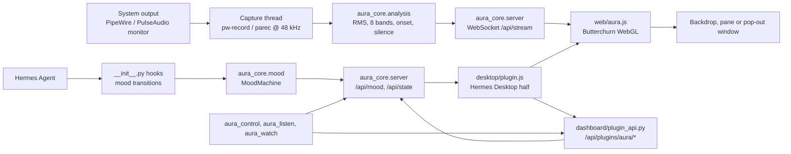

# Architecture

One line: the components, the audio and control data flow, and where Aura keeps its files.

Applies to Aura 1.0.0 · revised 2026-11-13

Aura is four layers that can be read one at a time. The Python core does capture,
analysis and HTTP; the browser page draws; the desktop half renders Hermes UI;
the plugin glue turns agent hooks into moods and exposes three tools.

## Data flow

The page never opens the audio device itself. The server reads the machine's
output loopback, reduces each 1024-sample frame to a small feature set, and
streams raw PCM plus feature events over one token-gated WebSocket
(`aura_core/server.py`, `_handle_ws`). `web/aura.js` feeds the PCM to Butterchurn
and uses the features for level, bands, silence gating and mood transitions.

## The four layers

| Layer | Files | Job |
|---|---|---|
| Capture | `aura_core/capture/*.py` | Probe backends in `PROBE_ORDER` (`pipewire`, `pulse`, `wasapi`, `macos`, `none`), start a monitor recorder, restart it if it dies. |
| Analysis | `aura_core/analysis.py`, `aura_core/window.py` | Hann-windowed FFT, RMS level, eight bands, onset detection, silence hold, centroid and flatness. |
| Server | `aura_core/server.py`, `aura_core/sessions.py`, `aura_core/radio.py`, `aura_core/search.py` | Local HTTP + WebSocket server, single-leader election, player command queue, radio proxy, keyless YouTube search. |
| Surfaces | `web/`, `desktop/plugin.js`, `dashboard/plugin_api.py`, `__init__.py` | Visualiser page, film stage, Hermes Desktop UI, dashboard routes, tools and hooks. |

`__init__.py` is the plugin entry point. It registers the three tools and eleven
hooks, then warms the server from a daemon thread so `register()` never blocks
(`__init__.py`, `register`).

## Single server, one token

Every plugin load does not start its own server. `aura_core/server.py` uses a
`fcntl.flock` lock (`~/.hermes/aura/server.lock`) to elect one leader per Hermes
home. The leader writes `lease.json` with `{pid, port, token, started, capture}`;
followers forward control calls to it. On Windows, where `fcntl` is absent, the
import is guarded and each process keeps the previous per-process behaviour
([LIMITS.md](../LIMITS.md)).

The server binds `127.0.0.1` on a free port. Every data endpoint and the
WebSocket require the per-launch bearer token; static assets under `web/` are
served without it because `<script src>` cannot attach headers. The dashboard
half is the only door the desktop UI uses: `dashboard/plugin_api.py` asks the
already-imported server module for its live port and token and forwards calls
(`_live`, `_forward_json`), so the UI never guesses a port.

## Data on disk

All paths derive from `HERMES_HOME` (default `~/.hermes`); see
`aura_core/config.py`.

| Path | Contents |
|---|---|
| `~/.hermes/aura/config.json` | Settings, mode `0600`, atomic replace. Corrupt or missing input falls back to defaults. |
| `~/.hermes/aura/token` | Per-launch bearer token, mode `0600`. |
| `~/.hermes/aura/server.lock` | Leader-election lock. |
| `~/.hermes/aura/lease.json` | Leader advertisement: pid, port, token, start time, capture backend. |
| `~/.hermes/aura/radio_favorites.json` | Saved radio stations (`aura_core/radio.py`). |
| `~/.hermes/runtime/active_sessions.json` | Read-only: live Hermes chat sessions, used for the intensity boost. |
| `BUILD_INFO.json` (gitignored) | Optional build stamp read by `aura_core/version_stamp.py`. |

Nothing else is written. Audio samples stay in memory.

## Key files

| File | Why you would open it |
|---|---|
| `plugin.yaml` | Manifest: version, Hermes floor, tools, hooks, dashboard. |
| `__init__.py` | Tool schemas and handlers, hook-to-mood mapping, server boot. |
| `aura_core/server.py` | HTTP routes, WebSocket streaming, player queue, window control, single-server election. |
| `aura_core/config.py` | Defaults, coercion, atomic load/save, file locations. |
| `aura_core/mood.py` | Mood state machine: attention floors, TTLs, restore-on-clear. |
| `aura_core/analysis.py` | The FFT and feature extractor. |
| `aura_core/capture/base.py` | Backend probing, the recorder/restart loop, idle-silence behaviour. |
| `aura_core/radio.py` | Radio Browser search, favourites, `.pls`/`.m3u` resolution, SSRF guard. |
| `aura_core/search.py` | Keyless YouTube search and play-URL validation. |
| `aura_core/quality.py` | A film's real versions: archive.org `/metadata/<id>` parsing, short timeout, per-item cache; YouTube's honest auto answer. |
| `aura_core/window.py` | Chromium app window: browser lookup, profile, tickets, close on exit. |
| `dashboard/plugin_api.py` | Desktop-facing routes and playlist resolution. |
| `desktop/plugin.js` | Hermes Desktop half: status menu, pane, page, window, backdrop, audio channel. |
| `web/aura.js` | Visualiser, preset catalogue, mood rendering, WebSocket client. |
| `web/player.html`, `web/audio.js` | Film stage and the separate audio channel. |
| `web/quality.js` | The quality rules the page and its contract test both run: what YouTube can be told, and the source swap that keeps the second. |
| `web/catalog.json` | The shelf catalogue (346 verified titles), built by `tools/build_catalog.py`. |

Back to [docs/README.md](README.md).
