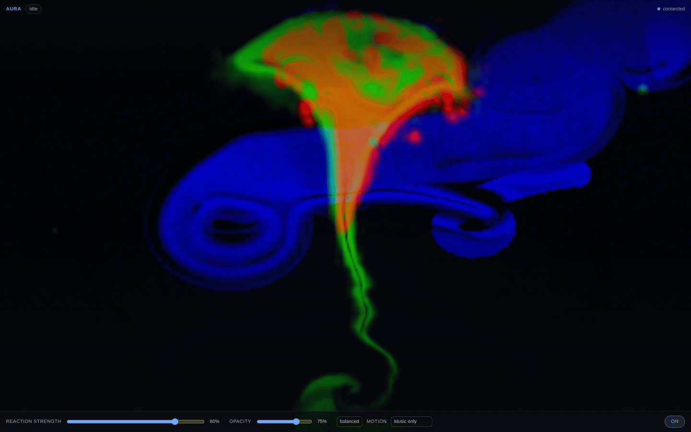
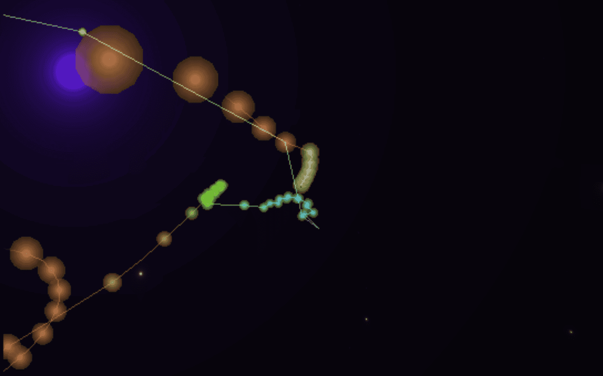

# Usage

One line: a walkthrough of every user-facing part of Aura, from the first film to radio and the agent tools.

Applies to Aura 1.0.0 · revised 2026-11-11

## Turn it on

Install the plugin, then enable it in **Settings ▸ Plugins ▸ Aura**. Nothing is
captured until Aura is enabled. The Aura pane appears on the right; closing it
leaves only the status-bar menu.

*The visualiser page with the skylight preset. Reaction strength, opacity,
behaviour profile and motion source are the real controls at the bottom.*

## Play a film while you work

1. Open the status-bar **A** menu and choose a saved source, or paste a URL.
2. The film opens in the docked theatre pane on the right: a 16:9 stage with a
   scrubber, transport, volume and a poster list of your sources.
3. Close the pane and the film keeps playing; the status-bar menu brings it back.

Accepted sources are YouTube videos, YouTube playlists, and direct MP4/WebM
files. A film remembers where you stopped, keyed by URL, so switching sources
never restarts it. A film that reaches the end is not remembered at its last
second.

## Add a YouTube playlist

1. Open the playlist on YouTube.
2. Press **Share**, then **Copy link** — it looks like
   `https://youtube.com/playlist?list=PL…`.
3. On the Aura page, paste it into the Library box, give it a name if you like,
   and press **Add**.

Public and unlisted playlists play here. Private playlists cannot be embedded
and are not supported.

Playlist episodes are resolved server-side. If an item forbids embedding or has
been deleted, Aura skips to the next playable episode instead of breaking the
whole list.

## Move the film between surfaces

The film exists in one place at a time:

- **Docked pane** — beside the chat, for working with it visible.
- **Aura page** — the whole product in one screen: stage, transport, Library,
  settings.
- **Pop-out window** — ordinary Chromium on its own profile, so it can go
  full-screen on another monitor.

Use **Pop out** on the page or the control strip. The window opens at the second
the in-app player had reached, and the in-app player pauses so two copies never
play with sound. **Pop in** closes it. If the Aura server restarts or the app
quits, the window closes with it.

The pop-out needs Chrome or Chromium. Set `AURA_DESKTOP_BROWSER=/path/to/chrome`
if it cannot find one.

## Manage a playlist where it lives

`☰` hands the list to the pop-out window, which is real Chromium on Aura's own
profile. YouTube's own page opens, so adding, removing and reordering work with
your own session. No API scope, no OAuth review, no second account.

## The Aura page

The sidebar **Aura** page puts the same player in a big 16:9 frame with the
transport, volume and source picker. Under it:

- **Library** — poster cards; add, rename, remove, hide starters, clear recents.
- **Playlist how-to** — the three steps above, in place.
- **Settings** — every control Aura has.

**Pop out** floats the film into a watch window; **Bring back** returns it. The
film moves into the page while it is open and goes back when you leave.

One library feeds two pickers: the source dropdowns in the A menu and in
Settings both list saved playlists, your films, the starter pack and recents,
grouped under `Playlists`, `Your films`, `Starters` and `Recent`.

## Watch the visualiser

Switch the film off and the same system audio drives a MilkDrop-compatible
WebGL visualiser behind the interface.

- Driven by system audio: level, eight bands, onset and silence gating.
- Backdrop opacity that follows the room: dim when quiet, brighter with music.
- Optional accent pulse and agent moods: thinking, running tools, waiting for
  approval, erroring, streaming, finished. Each restores itself; nothing latches.

A film owns the screen while **Backdrop** is **Video player**: Style, Intensity,
the Aura transparency and Gentle motion are greyed out, and Show is forced to
Always in effect. Your stored Show choice is not overwritten.

## Listen to anything

Aura listens to more than a film's soundtrack. Internet radio, direct audio
files and streams play on their own channel, beside the video and independent
of it.

- **Radio** — a curated starter list (SomaFM, NTS, KEXP, FIP, Radio Paradise,
  BBC World Service and more), search across the Radio Browser directory by name
  or genre tag, and favourites that persist between sessions. `.pls` and `.m3u`
  playlists are resolved server-side.
- **Direct audio** — any public `http(s)` URL to mp3, ogg/opus, aac/m4a, flac or
  wav.
- **Music on, video muted** — the audio channel has its own volume and mute.
  The muted state is remembered with the film.
- **Visuals follow it** — music from Aura's channel (or any other app) drives
  the same visuals.

## Talk to Hermes

Because the server is the remote, the chat can drive the film without alt-tab:

- “pause” / “resume” / “next episode” / “go back an episode”
- “jump to 40 minutes” (seek)
- “put it on my other screen” / “pop the film out” / “bring it back into Hermes”
- “find me something to watch” → numbered choices → “the second one”
- “find me some jazz radio” → numbered choices → “the second one”

The agent calls `aura_control`, `aura_watch` and `aura_listen`; see
[REFERENCE.md](REFERENCE.md) for every action and parameter. Search never
autoplays: options are shown, and playback waits for your pick.

## Stop it, remove it, find your data

- **Stop now:** turn Aura off in **Settings ▸ Plugins ▸ Aura**. Capture stops,
  the mood machine resets, and every effect Aura applied is removed.
- **Restore the theme:** **Restore my theme** removes the host styling Aura
  added.
- **Uninstall:** remove the plugin through Hermes' plugin list. No background
  process survives that; the local server exits with the plugin process.
- **Data:** settings, token, lease, lock and radio favourites live in
  `~/.hermes/aura/` ([CONFIGURATION.md](CONFIGURATION.md)). Delete that folder
  to remove everything Aura stored.

Back to [docs/README.md](README.md).
